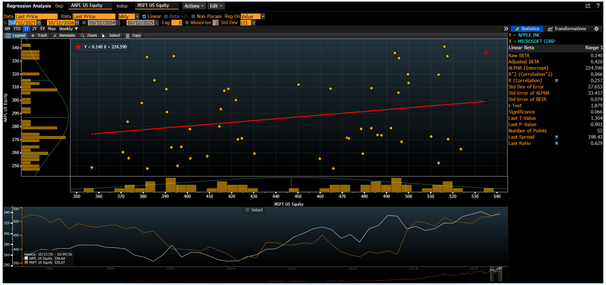
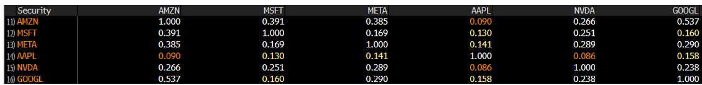

```{r setup, include=FALSE}
knitr::opts_chunk$set(echo = TRUE)
```

```{r analisis_tarea4, message=FALSE, warning=FALSE}
library(readxl)

archivo <- "Tarea3_Bloomberg_Datos.xlsx"

raw <- read_excel(
  archivo,
  sheet = "1 MIN",
  col_names = FALSE
)

datos <- data.frame(
  AAPL  = suppressWarnings(as.numeric(raw[[2]])),
  MSFT  = suppressWarnings(as.numeric(raw[[5]])),
  GOOGL = suppressWarnings(as.numeric(raw[[8]])),
  META  = suppressWarnings(as.numeric(raw[[11]])),
  NVDA  = suppressWarnings(as.numeric(raw[[14]])),
  AMZN  = suppressWarnings(as.numeric(raw[[17]]))
)

datos <- na.omit(datos)

head(datos)
dim(datos)

# Regresiones lineales simples
modelo_msft  <- lm(AAPL ~ MSFT, data = datos)
modelo_googl <- lm(AAPL ~ GOOGL, data = datos)
modelo_meta  <- lm(AAPL ~ META, data = datos)
modelo_nvda  <- lm(AAPL ~ NVDA, data = datos)
modelo_amzn  <- lm(AAPL ~ AMZN, data = datos)

summary(modelo_msft)
summary(modelo_googl)
summary(modelo_meta)
summary(modelo_nvda)
summary(modelo_amzn)

# Matriz de correlación
cor(datos)
```


```{r resumen_modelos}
resumen_simples <- data.frame(
  Variable = c("MSFT", "GOOGL", "META", "NVDA", "AMZN"),

  Coeficiente = c(
    coef(modelo_msft)[2],
    coef(modelo_googl)[2],
    coef(modelo_meta)[2],
    coef(modelo_nvda)[2],
    coef(modelo_amzn)[2]
  ),

  R2 = c(
    summary(modelo_msft)$r.squared,
    summary(modelo_googl)$r.squared,
    summary(modelo_meta)$r.squared,
    summary(modelo_nvda)$r.squared,
    summary(modelo_amzn)$r.squared
  ),

  P_value = c(
    summary(modelo_msft)$coefficients[2,4],
    summary(modelo_googl)$coefficients[2,4],
    summary(modelo_meta)$coefficients[2,4],
    summary(modelo_nvda)$coefficients[2,4],
    summary(modelo_amzn)$coefficients[2,4]
  )
)

resumen_simples
```

## Interpretación de las regresiones simples

Al revisar las cinco regresiones, todas las variables resultaron estadísticamente significativas, ya que sus p-values son menores a 0.05. Sin embargo, no todas explican de la misma manera los movimientos de AAPL.

MSFT fue la variable con mayor poder explicativo, con un R² de 0.8158 y una relación positiva con AAPL. Esto quiere decir que en esta muestra los movimientos de MSFT y AAPL estuvieron bastante relacionados.

NVDA también presentó un R² alto de 0.8050, aunque en este caso el coeficiente fue negativo. META tuvo un R² de 0.7151 y una relación positiva.

GOOGL mostró una relación positiva, pero con un R² mucho menor de 0.1086. Finalmente, AMZN tuvo el menor poder explicativo, con un R² de 0.0269, aunque su relación también resultó significativa.

En general, los resultados muestran que algunas acciones del mismo sector se mueven de manera mucho más cercana a AAPL que otras. Esto no significa que una acción cause los movimientos de otra, sino que durante el periodo analizado tuvieron una relación estadística más fuerte.


## Preguntas del Capítulo 16 - Gujarati

### 16.1 ¿Cuáles son las características especiales de los datos de corte transversal, series de tiempo y datos de panel?

Los datos de **corte transversal** comparan varias unidades en un mismo momento, por ejemplo diferentes empresas en un mismo año.

Las **series de tiempo** analizan una misma variable a través de varios periodos, por ejemplo el precio de una acción durante varios años.

Los **datos de panel** combinan las dos cosas, porque observan varias unidades y además las siguen a través del tiempo.

### 16.2 ¿Qué se entiende por modelo de efectos fijos (MEF) y cómo considera las dimensiones de tiempo y espacio?

El modelo de efectos fijos permite que cada empresa, persona o unidad tenga características propias que la diferencien de las demás.

La idea es que estas diferencias se reflejan en un intercepto distinto para cada unidad, pero que ese efecto se mantiene constante en el tiempo.

De esta forma el modelo toma en cuenta tanto las diferencias entre las unidades como la información que tenemos de ellas a través de varios periodos.

### 16.3 ¿Qué es el modelo con componentes del error (MCE), en qué difiere del MEF y cuándo utilizar cada uno?

El MCE, también llamado modelo de efectos aleatorios, considera que las diferencias entre las unidades forman parte del error del modelo y se comportan de manera aleatoria.

La diferencia principal es que en efectos fijos cada unidad tiene un efecto propio, mientras que en efectos aleatorios ese efecto se considera parte de una población más grande.

Si las características particulares de cada unidad están relacionadas con las variables que estamos usando, sería más adecuado utilizar efectos fijos. Si no existe esa relación, podría utilizarse efectos aleatorios.

### 16.4 ¿Hay diferencia entre MCVD, estimación dentro de grupos y primeras diferencias?

Sí hay diferencia en la forma en que trabajan, aunque los tres buscan controlar las diferencias particulares que existen entre las unidades.

El MCVD utiliza variables dummy para distinguir a cada unidad. El método dentro de grupos trabaja con las diferencias respecto al promedio de cada unidad y primeras diferencias compara cada observación con la anterior.

Por eso el objetivo es parecido, pero la forma en que se transforman o utilizan los datos cambia.


## Evidencia de Bloomberg

### Regresión lineal simple



La regresión realizada en Bloomberg sirve como referencia para comparar el comportamiento de AAPL frente a MSFT. En RStudio se utilizó información de 1 minuto, mientras que la captura de Bloomberg corresponde a otra frecuencia, por lo que los resultados no son directamente iguales. Aun así, ambas permiten observar la relación entre las dos acciones. 

### Matriz de correlación



La matriz de Bloomberg también permite ver qué acciones se mueven de manera más parecida entre sí. Al compararla con RStudio se observa la misma idea general, aunque los valores cambian por la frecuencia y el periodo utilizado.


## Evidencia HowTheMarketWorks


En HowTheMarketWorks mantengo posiciones en AAPL, JPM y XOM. Para esta actividad AAPL fue la acción utilizada como variable dependiente en el análisis del sector tecnológico.